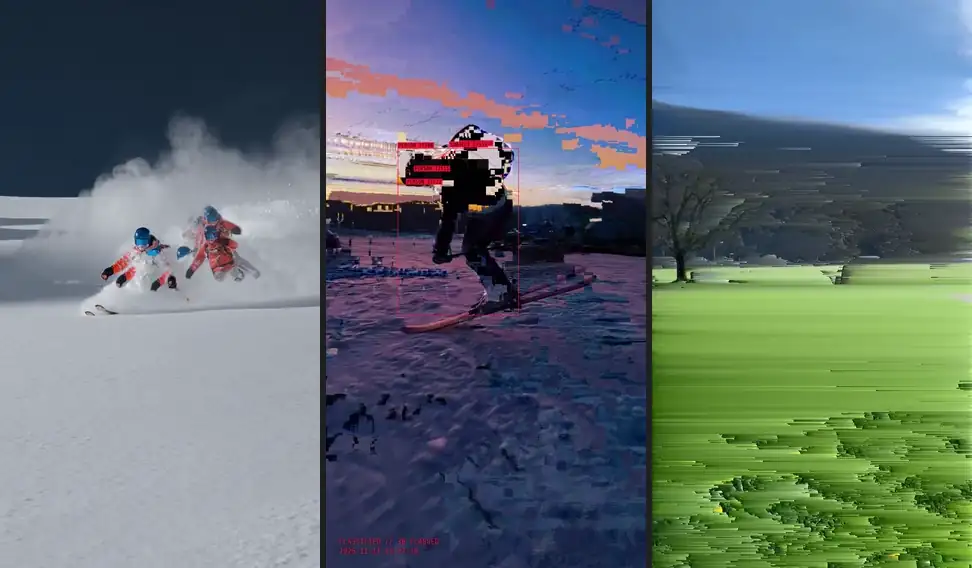
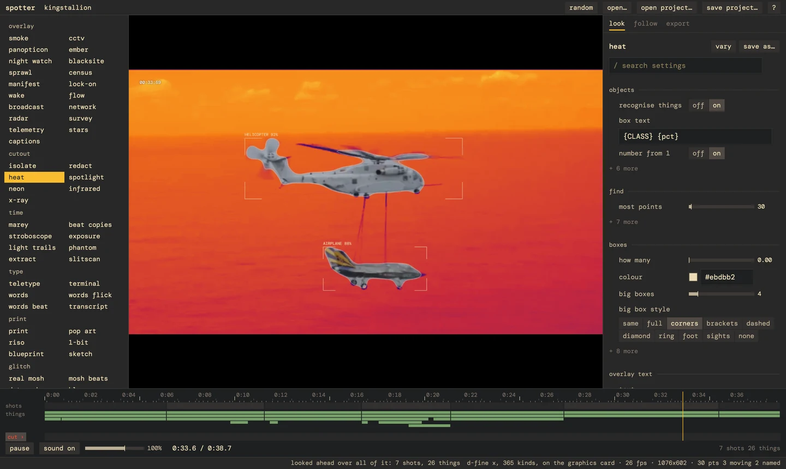

# spotter



spotter tracks what moves in a video and draws over it. its models run on the gpu, and it looks over
the whole clip before it draws anything.

80 looks out of the box, and you can mix them together. mess around and have fun.

windows only for now, on any gpu with dx12.

## install

download the zip from releases and run `spotter-app.exe`, or build it with rust:

```
cargo run --release -p spotter-app
```

the first run offers to download ffmpeg (115 mb) if you don't have it. models come from hugging face
the first time a look needs one.

## use



pick a look on the left. `?` shows the keys. it works from the command line too:

```
spotter render clip.mp4 --look heat --shape reel
spotter render project.spotter --still 4.5
spotter looks
```

## licence

mit. the models spotter downloads keep their own licences, and depth anything v2 large and segformer
are non-commercial only.
